<!-- SPDX-FileCopyrightText: 2026-2026 Wilson Snyder
     SPDX-License-Identifier: LGPL-3.0-only OR Artistic-2.0 -->

# RFC: native VHDL frontend for Verilator

Status: draft for maintainer discussion. This is a design proposal, not a pull
request. Please decide the scope questions at the end before review effort is
spent on the 371-commit working branch.

## 1. Motivation

VHDL IP commonly sits inside otherwise-SystemVerilog SoCs. Today the workflow
needs an external analyzer or a VHDL-to-Verilog translator, with a second set of
diagnostics and a translation boundary that hides the real source location.
`--language vhdl` should be a first-class Verilator mode: one invocation, one
AST, one set of diagnostics, no external process.

## 2. Proposal

Parse synthesizable VHDL-2008 directly, elaborate it, and lower it into the
existing V3 AST. There is **no new V3 AST node, no new pipeline pass, and no
new runtime primitive** that exists only for VHDL. There is no external
analyzer, no GHDL/nvc dependency, and no GPL-only component. Files ending in
`.vhd`/`.vhdl` select the VHDL frontend; `--language vhdl` selects it for other
extensions.

## 3. Non-goals

- Full VHDL simulation semantics, including 9-state resolution and `std_logic`
  strength tracking.
- Access, protected, file and `textio` runtime types; user-defined resolution
  functions.
- VHDL-2019 as a baseline, general `wait`/delay timing, fixed- and
  floating-point packages.
- VHDL-to-SystemVerilog binding inside one elaborated netlist beyond the
  boundary described in section 6.

Constructs outside the subset are refused with a located diagnostic, not
silently ignored.

## 4. Semantics

| Area | Contract |
|---|---|
| Values | Runtime model is two-state. `std_logic` collapses to 0/1; `'U'`, `'W'`, `'X'`, `'-'` are X in constants and 0/1 at run time. `'Z'` is kept for a tristate driver and resolves to 0 elsewhere. |
| Drivers | One driver per non-tristate signal. Conflicting enabled tristate drivers resolve to 1 where VHDL gives `'X'`. No user resolution functions. |
| Inout | With `--pins-inout-enables`, a top-level `inout` is an input plus `name__en`/`name__out`; use this when an external driver exists. Without it the C++ interface exposes one two-state field holding the externally supplied value. There is **no guaranteed OR** of external and internal drivers and no IEEE 1164 resolution. |
| Integers/ranges | `integer` is 32-bit signed; `natural`/`positive` are subtypes. Bounds are checked statically, not at run time. Enumeration encoding follows declaration order. |
| Arrays/records | Packed into one wide vector; indexing becomes a bit select and a dynamic index a variable part-select. There is no per-element V3 variable or type, so cost grows with packed width. |
| Assert/report | Accepted. Static assertions may fold at elaboration; a literal report message prints, `severity failure` ends the run, and a non-literal message is dropped. |
| Timing | `after`, `transport`, `inertial`, `reject` and `wait for` are refused; a limited top-level clock-wait testbench model exists under `--binary`. |

Object initialized with no value or reset starts at 0, including `integer`
(VHDL would give `T'left`). This is a deliberate divergence for C++/SV users.
The full divergence table is in `docs/vhdl/limitations.rst`.

## 5. Architecture

```mermaid
flowchart LR
    A[VHDL / SV source files] --> B[readFiles: extension dispatch]
    B --> C[V3VhdlParse driver]
    C --> D[Lexer]
    D --> E[Parser / frontend AST]
    E --> F[Elaboration: packages, generics, instances]
    F --> G[Lowering: 7 domain translation units]
    G --> H[Committed pre-width V3 AST modules]
    H --> I[V3LinkCells]
    I --> J[V3VhdlLink contract check, debug builds]
    J --> K[V3Width and the existing middle end]
    K --> L[V3EmitC]
```

Pass order in `Verilator.cpp` is unchanged. The frontend emits **committed
pre-width AST**: dtypes are already canonical, `AstParseRef` and `childDTypep`
are gone, and every expression and variable has a dtype. `V3Width` therefore
leaves those nodes alone. This is the single architectural decision that needs
acceptance or rejection: an alternative would be to emit parse-shape AST and
add VHDL-aware width/link passes, at the cost of new V3 semantics and a larger
core diff.

`V3VhdlLink` asserts the committed shape inside `readFiles`, after
`V3LinkCells` and before `V3Width`. It runs in every debug build without a flag
and compiles out in release. `t_vhdl_tree` pins one entity's emitted tree.

## 6. Integration

- Core surface: one language enum, one `V3Global` bool, per-file dispatch in
  `readFiles`, a 45-line change in `V3LinkCells`, build-list entries, and the
  contract-check unit. No changes to pass order.
- Mixed language: an SV top may instantiate a VHDL entity in one invocation;
  a VHDL hierarchy can be built as a `--lib-create` library and instantiated
  from SV. A VHDL design cannot instantiate an SV module directly. Only
  design-unit instantiation crosses the boundary: no shared types, package
  imports or cross-language hierarchical references.
- Source layout: lexer, parser/AST, package elaboration, and seven lowering
  units (`types`, `expr`, `stmt`, `subprog`, `process`, `package`, `elab`) with
  two private headers. The largest unit is ~3.5k lines; the `Lowering` class
  declaration is ~1.1k lines.
- Frontend total is ~20.2k lines. Against base `53a72711` the branch is 371
  commits, 1005 files, ~58k insertions (including tests).

## 7. Evidence

- 324 regression drivers, 76 diagnostic/tree goldens, 329 `.vhdl` fixtures,
  227 value-checked C++ harnesses, 237 `vlt_all` tests.
- Full VHDL suite: 324 passed / 0 failed in ~15 s on 16 cores locally. Both
  distribution tests (`t_dist_test_style`, `t_dist_copyright`) pass. The suite
  needs only the built Verilator and a C++ compiler; no test invokes GHDL or
  nvc.
- External GHDL corpus sweeps and real-design runs were done during
  development but their inputs are not in this repository; those numbers are
  **not reproducible from a checkout** and are not offered as evidence here.

## 8. Known limitations

- Dynamic-index driver counts and `std_logic_vector` `MULTIDRIVEN` diagnostics
  are imprecise.
- `std_logic_signed` arithmetic and comparison, `case generate`, matching
  `case`, enumeration range subtypes, resolution indications and some type
  attributes are not implemented.
- PSL directives are skipped. Library namespace handling is simplified.
- Zero-width objects outside a whole-array assignment are not modelled; some
  legal constructs are falsely rejected as `BLKANDNBLK` or `ASSIGNIN`.
- Large memories and some whole-core elaborations can exhaust memory.

## 9. Maintenance plan (proposal)

- Owner: Hannes Klas, who wrote the frontend, triages new unsupported
  constructs and keeps `docs/vhdl/limitations.rst` current.
- Every deliberate refusal goes through one helper with a source location and
  gets a diagnostic golden; a new accepted construct gets a value-checked C++
  harness. Regressions are caught by the VHDL suite plus the two distribution
  tests.
- The frontend is always built; no optional CMake/Makefile configuration.
- Reviewers needed: one for the parser/elaboration boundary, one for the
  lowering units and the pre-width AST contract.

## 10. Staged delivery

| PR | Scope | Why it is reviewable |
|---|---|---|
| 0 | Language plumbing, extension dispatch, build lists, option tests | Small core change, no parser |
| 1 | Lexer, parser, frontend AST, first diagnostic goldens | Syntax and errors in isolation |
| 2 | Flat RTL lowering: entities, ports, signals, operators, `std_logic` | First useful C++ model |
| 3 | Processes, sequences, variables, clocks and resets | Value-checked harnesses |
| 4 | Hierarchy, generics, packages, records, unconstrained ports | Hardest semantics, isolated |
| 5 | Subprograms, `numeric_std`, attributes, reports | Library semantics last |
| 6 | Tristate/inout, `--pins-inout-enables`, limited timing | Optional for a first merge |
| 7 | Mixed-language and `--lib-create` | Defer unless required for merge |

### Questions for maintainers

1. Is VHDL in scope for Verilator at all?
2. Is emitting a committed pre-width AST acceptable, or must width/link gain
   VHDL-aware passes?
3. Which mixed-language boundary is required for a first merge?
4. Is a staged stack acceptable, or do maintainers prefer one feature PR with
   a reviewer guide?
5. What CI and performance bar must the first merge clear?
6. Who will review the lowering and who maintains it after merge?
